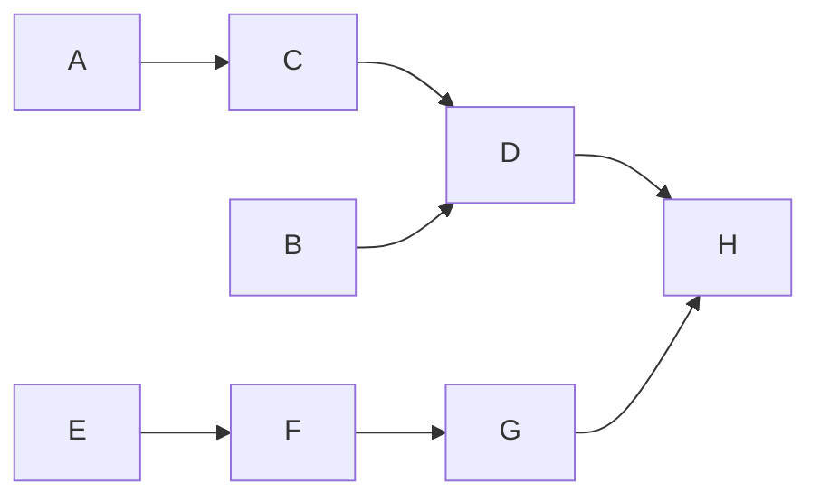

# Shared job system

Status: Planned. V01-V19 are new work; no scheduler or language wrapper is implemented.
See the [macro roadmap](../plano-de-desenvolvimento.md) and [task diagram](../task-dependencies.md).

## Scope and architecture

Build one C++20 scheduler implementation, `raiders_jobs`, usable independently of
World, rendering, the sample, Lua and editor UI. Native tools and the engine link
it directly. A versioned Windows C ABI supplies the same implementation to
`Raiders.Jobs` (.NET 10/NuGet) and `raiders-jobs` (installed Python binary wheel).
Each process owns its scheduler instance and budget; DLL reuse does not make a
thread pool shared across processes. Wrappers must not implement separate DAG engines.

The game/main thread owns simulation orchestration and the event pump. A dedicated
render thread owns presentation/backend calls. Both submit eligible CPU work to
a configurable pool: initially target four workers, allow five and smaller
budgets, and validate one-worker operation. Thread counts are policy, not constants
embedded in gameplay. Account for logical/physical cores, UI, child processes,
native libraries' own threads and concurrent workloads before selecting defaults.

Use bounded work descriptors and ready queues. Only runnable jobs occupy workers;
predecessor completion releases continuations. Express intermediate synchronization
as graph edges or joins instead of serial `Wait` calls on the main thread. Explicit
fences remain available at actual ownership boundaries, external consumers and
shutdown. A worker must never park waiting for its own queued descendants.
Do not introduce a second worker pool per subsystem or an unbounded thread per job.

Dependencies impose order, not physical worker placement. A chain may move between
workers; explicit main/render/UI lanes provide affinity where required. A ready
main/render callback is pumped by its owning thread, never stolen by a worker.
Keep blocking I/O and external compiler processes out of the CPU worker pool;
completion bridges re-enter the graph under the same admission/process budget.

### Graph and child completion contract

The requested fork/join example is a mandatory test fixture:

A, B and E may run concurrently. D requires both B and C; H requires both D and G.
Dependencies are registered before publishing runnable work. Support fan-out,
fan-in, multiple producers, empty groups and completed prerequisites. Define
release/acquire publication so a successor sees its predecessors' results.

A job's public completion means its body **and all descendants** have terminated.
Its body may create children with their own local dependencies and continuations.
Seal each child builder before releasing its parent's final completion reference;
late child registration is rejected rather than racing a zero counter. A successor
of a parent must not observe completion while a child or grandchild remains active.
The waiting parent is a completion record, not an occupied worker stack.

Reject cycles, self-dependencies, parent-completion dependencies inside that
parent's descendants, stale/cross-scheduler handles and capacity exhaustion with
useful diagnostics. Static graph validation occurs before activation; dynamic
children use constrained structured registration with the same lifetime rules.
Successful prerequisites and terminal prerequisites are different concepts:
failures/cancellation normally skip data consumers, while explicit cleanup
continuations can run after terminal completion. Every accepted job reaches a
terminal state and releases references exactly once, including error paths.

Cancellation is cooperative. Shutdown closes admission, settles queued work,
joins executing callbacks/children, then releases runtime and interop resources.
No forced thread termination, unmanaged exception escape or silent abandoned jobs.
Job payload ownership must remain valid through the last dependent/child access.
Dependencies alone do not make unrelated writes race-free: consumers must define
read/write ownership, immutable inputs and explicit merge/publication steps.

### Language and runtime boundaries

- Native consumers share the scheduler library and stable C ABI error/status model.
  Generation-bearing opaque handles prevent reuse/ABA errors. Callbacks never run
  under scheduler-internal locks. Version and runtime architecture are checked.
- C# uses SafeHandle ownership, rooted callback state and exception-to-result
  translation. `Task`/awaitable completions are bridges to native completion, with
  continuations dispatched outside native locks. UI work returns through its
  synchronization context. Dispose/cancel cannot free a callback still in flight.
  See [Microsoft interop guidance](https://learn.microsoft.com/en-us/dotnet/standard/native-interop/best-practices).
- CPython 3.12 has a GIL: pure Python callbacks do not gain CPU parallelism merely
  by entering native workers. Prefer native kernels that release the GIL; use
  explicitly budgeted subprocesses for Python CPU work. Futures integrate with
  scheduler completion; Python callbacks acquire the GIL or return to their owning
  interpreter thread. Never call into a finalizing interpreter or retain borrowed
  references after their lifetime. Ship DLLs in wheels; venv setup needs no compiler.
  See [Python's threading contract](https://docs.python.org/3.12/library/threading.html).
- Lua gets no scheduler wrapper in this scope. Its VM remains owner-thread-bound;
  native work can publish results back to the game/VM lane before Lua callbacks.
- Designers receive runtime-complete tools and native dependencies through the
  Designer SDK; runtime job execution does not require C++, C#, Python build tools
  or cooking during editing. Packaging is still explicit.

### Debugging, profiling and design reference

Expose job/group names, stable capture IDs, parent/child and prerequisite edges,
lane, queue/ready/start/end times, cancellation/fault reasons and bounded counters.
Distinguish body CPU-worker occupancy, elapsed dependency wait and inclusive group
lifetime; summing parents and children is not total CPU work. Correlate with T04,
T05 and T06 sessions, preserving context explicitly across workers/processes.
Provide bounded graph dumps, a one-worker reproduction mode, debug assertions and
trace-based diagnosis of a stalled join. Interactive inspection belongs to C# tools.

The reference is David Block's GDC 2024 talk,
[The Job System in Cyberpunk 2077: Scaling Night City on the CPU](https://gdcvault.com/play/1034234/The-Job-System-in-Cyberpunk).
Its published description identifies a thread-based design, counters for inter-job
dependencies, composability and profiling. That motivates the direction here; this
plan is our design, not a reconstruction of proprietary internals. The talk page
was available in search, while the full slides/video were not verified in this review.
V01 compares thread/counter continuations with fiber/help-while-wait alternatives;
fibers, lock-free queues and work stealing are not prerequisites without evidence.

## Implementation backlog

Each task targets 3-8 changed paths, roughly 10 including build/package registration,
tests and lockfiles. Proposed paths are boundaries, not permission for a broad
rewrite; split before exceeding the budget. Tests use GoogleTest, MSTest and
pytest and stay under the owning project. Scheduler tests use controlled gates,
not timing sleeps as proofs of ordering or parallelism.

**V01 - Scheduler contract and design decision.** Depends: Q02, T01.
Paths (3-5): `docs/decisions/0002-job-system.md`, `docs/jobs.md`, this plan,
and at most two developer-reusable benchmark files if the design needs them.
Acceptance: API examples for fork/join, nested children, affinity, failure,
publication, lifetime and capacity; select initial queues/counters and worker-wait
policy; record benchmark questions. Spike artifacts used only by the agent stay local.

**V02 - Independent native job package and handles.** Depends: V01, A05.
Paths (5-7): `engine/jobs/{CMakeLists.txt,include/raiders/Jobs.h,src/Jobs.cpp,
tests/handle_tests.cpp}`, root build registration and a package config if needed.
Acceptance: C++20 library has no World/game/render dependency; scheduler ownership,
generation handles, one-thread execution and install/link smoke use GoogleTest.

**V03 - Configurable worker pool and bounded ready queue.** Depends: V02.
Paths (4-6): `engine/jobs/{include/raiders/Jobs.h,src/Jobs.cpp,src/ReadyQueue.h,
tests/worker_tests.cpp}`, module build and `docs/jobs.md`.
Acceptance: one/four/five workers, sleeping wakeup, bounded admission, external
submission and basic join; no thread-per-job, callback-under-lock or busy-spin default.

**V04 - Counters and dependency graph submission.** Depends: V03.
Paths (4-6): job graph API/implementation, scheduler dispatch, graph GoogleTests and build.
Acceptance: A/B/C/D/E/F/G/H order, fan-in/out, completed prerequisites, atomic
activation, memory visibility, duplicate edges and cycle/cross-scheduler rejection.

**V05 - Structured child jobs and group completion.** Depends: V04.
Paths (4-6): group/builder API, completion counters, scheduler and child GoogleTests.
Acceptance: parent body completion does not release successors before children or
grandchildren; child DAGs and empty groups work; seal/add races cannot complete early.

**V06 - Continuations, sync points and affinity lanes.** Depends: V05.
Paths (4-7): continuation/lane API, queue dispatch, join tests and usage docs.
Acceptance: dependency waits do not occupy workers; one-worker nested execution
cannot deadlock; explicit consumer fences, main/render lane pumps and invalid
ancestor waits have defined behavior. Order and physical affinity stay distinct.

**V07 - Cancellation, faults and deterministic shutdown.** Depends: V06.
Paths (4-7): cancellation/result API, worker/group teardown and shutdown GoogleTests.
Acceptance: errors skip dependent consumers, cleanup continuations run as specified,
running callbacks settle cooperatively, no late callbacks/use-after-free, and every
accepted job reaches exactly one terminal state under saturation and shutdown races.

**V08 - Job graph diagnostics and profiling.** Depends: V07, T04.
Paths (4-6): job diagnostics adapter, snapshot/dump API, trace tests and `docs/jobs.md`.
Acceptance: named jobs, edges, child lifetime, readiness/wait reasons, queue pressure,
worker/lane identity and failures are inspectable; trace output is bounded and
disabled instrumentation avoids payload construction; no worker stack needed for a join.

**V09 - Scheduler stress, serial oracle and performance baseline.** Depends: V08.
Paths (4-6): `engine/jobs/tests/{graph_tests,stress_tests}.cpp`, developer benchmark,
module registration and `docs/jobs.md`.
Acceptance: randomized acyclic graphs match a serial oracle, counter/handle reuse
and cancellation races pass, one-worker reproduction works, and one/four/five-worker
results report job granularity, contention and overhead without a promised speedup.

**V10 - Versioned Windows C ABI and native runtime packaging.** Depends: V09.
Paths (5-7): C header, DLL bridge, export/version definitions, ABI tests and package config.
Acceptance: C-only consumer uses opaque handles/error codes; no STL layouts or
exceptions cross ABI boundaries; callback ownership and shutdown are verified;
win-x64 native runtime is distributable without a source checkout/compiler.

**V11 - Raiders.Jobs NuGet and safe native lifetime wrapper.** Depends: V10, Q05, T05.
Paths (6-8): `tools/dotnet/Raiders.Jobs/{Raiders.Jobs.csproj,NativeJobs.cs,
JobScheduler.cs,tests/...}`, central versions and required lockfiles.
Acceptance: local NuGet consumer loads the matching win-x64 runtime; SafeHandle,
callback rooting, exceptions and disposal are safe under GC and outstanding work.

**V12 - Managed DAG, child builders and awaitable completion.** Depends: V11.
Paths (4-7): managed job/group APIs, awaitable bridge, MSTest fixtures and docs.
Acceptance: the same native dependency/child semantics appear through idiomatic C#;
await does not block the UI, cancellation settles native ownership, and UI callbacks
marshal to their owner. No second managed scheduler or CPU pool is introduced.

**V13 - Python binary wheel and native scheduler lifetime.** Depends: V10, Q06, T06.
Paths (6-8): `tools/pipeline/jobs/{pyproject.toml,src/raiders_jobs/...,tests/...}`,
native wheel packaging and dependency pins.
Acceptance: installed wheel includes matching native runtime, imports in a clean
venv, safely owns handles/buffers and propagates errors; no build tool at runtime.

**V14 - Python DAG/futures bridge and GIL-aware execution.** Depends: V13, Q07.
Paths (4-7): Python graph/group/future adapters, binding callbacks, pytest and docs.
Acceptance: native CPU kernels run with the GIL released, Python callbacks obey
interpreter affinity, explicit CPU subprocess work respects budgets, child results
settle cancellation, and interpreter shutdown cannot receive a late callback.

**V15 - Game/render frame graph and ownership handoff.** Depends: V09, B07, C03, D05.
Paths (5-8): runtime frame DAG, render submission snapshots, native lane pumps,
module registration and integration tests.
Acceptance: main/game and render orchestration use shared CPU workers; transform,
extraction and presentation dependencies are explicit; intermediate main-thread
waits are removed, frame buffers have bounded ownership/backpressure, and Lua/renderer
callbacks remain on their owners. Editing still uses source data without cooking.

**V16 - Parallel physics batches and deterministic result merge.** Depends: V15, E06, E07.
Paths (4-7): physics batch scheduling, broad/narrow-phase consumers, result merge
and serial-versus-parallel tests.
Acceptance: immutable inputs and disjoint writes prevent races; contact results
merge in defined order against the serial oracle, with simple rotated shapes and
bounded scratch memory. Do not claim cross-platform bitwise floating-point determinism.

**V17 - Shared C# tooling jobs, progress and UI handoff.** Depends: V12, J02, J06.
Paths (4-7): `Raiders.Tools.Common` job service, document ownership/cancellation,
progress bridge, MSTest and tooling docs.
Acceptance: document close cancels/settles outstanding work; bounded progress and
owner-thread publication keep editors/inspectors responsive; native preview still
uses the actual renderer and managed callbacks preserve telemetry context.

**V18 - Pipeline cooking graph and process-budget integration.** Depends: V14, I06, Q04, F06.
Paths (4-7): Python pipeline stage scheduler, subprocess completion bridge,
incremental-cook integration tests and packaging docs.
Acceptance: content dependencies and compiler/converter completions become native
job continuations; global per-process/child-process budgets prevent nested pool
oversubscription; failed/cancelled stages never publish partial artifacts. Editing
does not execute the packaging graph; binary-only designers can use distributed tools.

**V19 - Combined runtime/tool/pipeline performance acceptance.** Depends: V16, V17, V18.
Paths (4-6): representative integration workloads, benchmark configuration and
performance/operations docs; executable-specific changes are split when needed.
Acceptance: measured frame/preview responsiveness, throughput, starvation, memory,
queue pressure and shutdown under competing workloads; compare serial and bounded
parallel configurations, including one/four/five workers, and set defensible defaults.

## Consumer handoff changes

Basic extraction, logging adapters, serialized formats and synchronous import APIs
can be implemented before jobs. Integration gates require the shared scheduler:
J07/D10 consume V15; E09 consumes V16; K05/L07/S03 consume V17; I05 consumes the
native scheduler after V09, and V18 adds Python/process orchestration over I06.
O07 covers native and language-wrapper impact; O06 and T14 include V19 measurements.
No dependency on V is added to T06. Task edges in the owning plans are authoritative.
