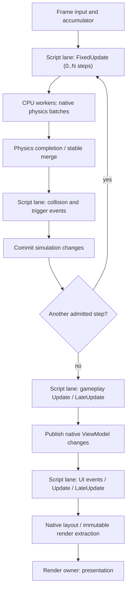

# Native runtime, Lua dispatch and job inspection design

Status: approved planning direction; no scheduler, embedded Lua runtime or editor
implementation is claimed by this document. Baseline: master `a2908c8` (A10, #32).
This incorporates the architecture review and the maintainer's subsequent decision
to serialize **all** Lua entry across gameplay and UI. It supersedes the proposed
parallel Lua VM pool, not the existing native job-system contract.

## Ownership and subsystem boundaries

Raiders Engine is C++20; Space Raiders is its sample. Components, systems, World,
physics, rendering, event dispatch, construction and runtime UI remain native.
Lua defines associated behaviors, never ECS component implementations. Interactive
developer tools use C#/.NET 10 and shared UI/resource NuGets (J09-J12). Pipelines
use C++ or packaged Python. Windows is the supported platform.

Keep entity definitions, live entities, native components/systems, behavior
definitions/instances, widgets, data sources and runtime handles distinct.
Use generation-aware handles; do not expose raw internal pointers or convert
64-bit identities through Lua floating-point numbers. Stable content/type IDs
are separate from reusable runtime handles. Detect persisted ID collisions.

C06 supplies shared native metadata to components, validation, typed construction,
inspectors, generated executable bindings (G19) and LuaLS definitions (G11).
I01 and I09 consume that metadata rather than maintaining competing registries.
Native types may be fixed by the binary; compatible asset catalogs remain open
to new content without recompilation. Compare contiguous component pools and
AoS/SoA with actual workloads before requiring archetypes or changing layouts.

## Two VMs, one serial script lane

Each runtime session owns at most two long-lived LuaJIT states: gameplay and UI,
created when their domains are present. Many behavior instances share a VM while
keeping instance state separate. There is no VM per entity, dynamic VM pool,
audio scripting VM, extra process or dedicated thread per VM.

Both VMs have the **same main/game-thread owner and one shared script lane**.
Gameplay and UI Lua never overlap, even when they target different VMs. This is
stronger than merely serializing each VM separately. Native CPU jobs can overlap
when resource ownership permits. The managed desktop UI thread is a different
owner from the native game-UI script domain.

Only the native script-dispatch service may enter either VM. Typed dispatch jobs
declare a domain and phase; the service appends them to the shared ordered lane.
Engine developers do not infer whether an arbitrary callback might access a VM.
Ordinary worker jobs cannot receive a VM pointer or executable Lua callback;
attempted off-lane entry is rejected by assertions/checked API boundaries.
Loading, module initialization, lifecycle, explicit reload, debugger evaluation
and teardown use the same owner and exclusion rule. Serial execution and owner
affinity are separate obligations; a dependency chain alone does not fix a thread.

No global mutex is acquired for each property access. Domain/resource permissions
are established before execution. Reentrant native-to-Lua dispatch is queued for
the next documented drain boundary, not recursively executed on another VM.
Debugger protocol pumping does not authorize unrelated gameplay callbacks.

Native work requested by Lua may create child jobs with owned native inputs.
Children cannot borrow stack slots, Lua tables, registry references or scoped
native views. The callback returns; a later script-dispatch continuation handles
the owned result. Never block a worker or the script callback waiting for its
queued descendants, and never retain a borrowed view across a yield.

## Lifecycle and destruction

These are Raiders lifecycle names, not a promise of Unity API compatibility:

| Callback | Delivery contract |
| --- | --- |
| `Awake` | Once per successfully constructed behavior instance, after required native properties/references exist and before normal activation callbacks. Not the C++ allocator/constructor. |
| `Enable` | Initial effective activation after Awake and every disabled-to-enabled transition. |
| `Start` | Once, before the first eligible FixedUpdate or Update; delayed while disabled. |
| `FixedUpdate` | Once per admitted fixed simulation step for active, started instances, with fixed delta and tick ID. |
| `Update` | Once per admitted presentation frame for active, started instances, with the domain's frame delta. |
| `LateUpdate` | After that domain's Update handlers and before its render-data extraction. There is no EndUpdate callback. |
| `Disable` | Once per effective enabled-to-disabled transition, including active-instance destruction. |
| `Sleep` | Once for an awakened instance during orderly destruction, after Disable when applicable and before native backing data is released. Not another name for Disable. |

Lifecycle ordering is per instance; no global all-Awake-before-all-Start guarantee
is implied for objects spawned later. Activation, hierarchy changes, spawn and
destruction take effect at defined structural commits. Pending destruction stops
new normal delivery. Cleanup callbacks are terminal continuations, not dependent
on successful gameplay completion. Sleep may inspect still-valid permitted native
data but may not resurrect the instance or schedule future gameplay work.

Callback exceptions produce diagnostics and disable the failing instance according
to G02. Cleanup is best-effort with unconditional native cleanup; an exception in
Disable/Sleep cannot leak subscriptions or prevent releasing other instances.
Failed construction before successful Awake rolls back without promising Sleep.
Process termination/crash cannot guarantee lifecycle delivery.

## Fixed simulation and frame sequencing

A fixed timestep is a simulation-time contract, **not** an independent periodic
thread or a hard real-time deadline. Main/game orchestration uses an accumulator.
Each presented frame can admit zero, one or several fixed steps; every admitted
step uses the configured fixed delta. Never pass a large variable delta to physics
as a substitute for several fixed steps. Do not inherit another engine's default:
choose named timestep/catch-up options with measurements. For scale, 50 ms means
20 Hz and 30 Hz is approximately 33.3 ms.

For every admitted step, use this causal order:

1. Commit eligible input/gameplay commands and lifecycle transitions; ensure Start.
2. Dispatch gameplay FixedUpdate on the script lane, allowing forces for this step.
3. Publish permitted script writes/commands to physics input.
4. Run native physics batches on CPU workers; merge results in stable order.
5. After the physics completion join, dispatch that tick's collision/trigger
   events on the script lane, with tick IDs and owned payloads.
6. Commit contact-handler changes and structural requests before the next step.

Collision/trigger Enter/Stay/Exit contracts and destruction behavior belong to
E03/G05/G25. Do not report old contacts as results of the current step. Before-physics
FixedUpdate and after-physics contact dispatch are distinct jobs on the same lane;
merging them into one blocking callback would prevent useful physics parallelism.

After all admitted fixed steps, dispatch gameplay Update, then LateUpdate and
commit permitted frame changes. Physics-affecting requests from these callbacks
are queued for the next fixed step; authoritative physics transforms are not
silently overwritten while the solver owns them. Non-physics properties follow
their declared ownership. Derive rendering snapshots/interpolation separately
from authoritative simulation state.

Publish the final gameplay data-source changes, drain UI notifications/input, then
dispatch UI Update and LateUpdate. UI has no physics FixedUpdate by default.
Commit UI writes before native layout/extraction; UI commands targeting gameplay
enter the next admitted simulation boundary. Native rendering presents immutable
owned snapshots. Completion of CPU preparation does not imply GPU/device completion.

Physics joins are DAG edges/continuations; an incomplete join does not occupy a
worker stack. A main-thread lane pump can return to permitted native orchestration
while waiting, but cannot execute later Lua phases before their predecessors.
Do not overlap simulation steps or reorder Lua batches merely to fill idle cores.
Set a bounded catch-up policy and expose remaining/dropped simulation debt rather
than hiding overload. Pause freezes simulation and timer/watchdog budgets; resume
does not inject paused wall time. Single-step executes one complete fixed step,
including its contact callbacks, followed by a documented UI/render refresh.

## Events, properties and cross-VM communication

C++ owns dispatch queues, subscriptions and payloads. Native immediate listeners
are allowed only under declared ownership/reentrancy rules. Lua listeners always
enter through script dispatch; no VM cross-call is made on the publisher's stack.
Same-domain notifications produced during a batch are drained in stable order at
its bounded tail; reentrant additions beyond that cutoff wait for the next drain.
Bound recursive chains and report backlog. Cross-domain notifications always wait
for the destination phase. Events are not automatically individual jobs.

Gameplay writes native state; publication updates native ViewModels and enqueues
owned UI notifications. UI dispatch invokes UI Lua, which modifies native widgets.
No stack slots, tables or closures cross VM boundaries. Same-frame visual updates
are possible because publication precedes UI/render extraction, without synchronous
gameplay -> UI -> gameplay recursion. Notifications of final property state may
coalesce; damage/contact/domain events preserve every required occurrence.

Use immediate writes with exclusive declared access, explicit commands across
ownership boundaries, and structural command buffers for invalidating changes.
Immediate reads see the new value. A queued command does not change published
state until commit; return acceptance/rejection separately. Do not introduce a
transparent read-your-writes overlay. Permissions never depend on worker choice.
Lua exceptions can discard unpublished commands, not automatically undo every
immediate write. Queues have capacities and explicit error/backpressure policies;
never silently drop critical gameplay events.

## Native jobs, construction and packaging

Preserve V01-V19's standalone scheduler, generation handles, release/acquire
publication, bounded admission, child sealing, fault/cancel semantics and C ABI.
No dedicated dispatcher thread must mediate every execution. Compare bounded
global queues against local queues/injection/work stealing before selecting
production algorithms. Fibers/lock-free structures are evidence-driven options.
Resource planning (V21) generates edges for the existing DAG; it is not a second
scheduler. Unknown/dynamic aliases require conservative access or staged work.
Quadtree query partitioning and job batch sizing are different decisions.

Source XML and Lua load directly during editing. Both source and cooked providers
feed shared validated typed construction descriptors. Resolve IDs/references,
allocate components, set properties, attach behaviors, then activate; failures
roll back partial objects and listeners. R10 adds asynchronous request cancellation
and settlement; R11 adds budgeted residency and measured shared costs.

Only explicit packaging cooks binary records, compatible LuaJIT bytecode and
eligible generated/compiled C++. Prefer native type registration plus binary data
for large content; avoid a C++ class per asset and closed catalogs. Designers add
compatible content without compilers. I08 compares logical state, lifecycle/event
ordering and rendered output across providers, normalizing runtime handles.

Pin LuaJIT revision, architecture, API/GC/frame compatibility and build options.
Bytecode is not native AOT or secrecy. Keep source maps/debug symbols in development;
test actual embedded breakpoints and separate debug/JIT performance modes.
Do not expose unrestricted FFI or introduce nonstandard Lua syntax for obfuscation.

## Play sessions and external subsystems

Play captures source assets/scripts and creates fresh World/VM state. Stop closes
normal admission, cancels/settles native and external operations, drains permitted
cleanup on the script lane, invalidates queued callbacks/views, then destroys VMs
and World. Session generations reject late completions. G09 explicit reload keeps
last-good code on failure and restarts instances; automatic live-state migration
is not required. Pause/debug pumping must preserve the same ownership contract.

No audio scripting VM is planned. Native audio ownership, callback constraints,
device completion and a possible XML/cooked mixer editor require separate scope.
R10/R11 are loading/residency foundations, not a claim of complete streaming.
AU01 records this missing subsystem's requirements before any audio implementation.

## Live job graph debugger

V22-V29 deliver a C#/.NET 10 application using shared resource/UI packages. It
attaches to actual native execution through bounded producer buffers and a
versioned local transport (named pipes are the initial candidate). Workers never
wait for the client. Sequence gaps, dropped events and session/build IDs allow
incomplete state to be shown honestly; resync/dumps are bounded. Do not route every
transition through the existing shared profiling mutex without measuring overhead.

Record creation, dependency/hierarchy edges, ready/start/body-end/public-terminal,
fault/cancel, lane/worker, timestamps and interned source locations. Public parent
completion includes descendants. Cross-worker lifetime uses explicit async events,
not a same-thread RAII scope stretched across workers. Producers do not allocate
unbounded strings or serialize JSON on the scheduling hot path. Capture must be
optional and removable in native builds.

White means unstarted, green executing, red publicly completed. Add accessible
icons/borders for ready, waiting, body-ended/waiting-children, failure, cancellation,
suspected stall and incomplete telemetry. Do not invent a suspended state if the
scheduler has none. Retain completed nodes for a configurable 500 ms by default.
New work appears on the right, history moves left; selection/pinning/manual pan
disables follow. Distinguish dependency edges from hierarchical containment.

Virtualize rendering and bound node/edge/history storage. Required live records
scale with throughput times retention; aggregate or disclose loss when over budget.
Keep bounded tombstones for edges to expired nodes. Selection shows prerequisites,
children, states, waits, occupancy, resources and fault reasons. Inclusive parent
time is not additional child CPU time. A long duration is not proof of deadlock.

MVP includes real attach, states, hierarchy, retention/follow, bounded loss reporting
and source navigation. Build/source maps validate revision/path and open an approved
VS Code/Visual Studio adapter at file/line; telemetry never supplies shell commands.
Native/Lua debuggers still own breakpoints. Later features include critical-path
analysis, capture comparison and aggregation. Z03 discovers the tool normally.

## Validation, benchmarks and delivery evidence

Use GoogleTest, MSTest and pytest under their owning projects. Verify DAGs against
a serial oracle; include one/four/five workers, children, overflow, cancellation,
failure and shutdown. Check that both VMs can never overlap, ordinary workers cannot
enter Lua, and native jobs still overlap when permitted. Real embedded Lua tests
must cover lifecycle, frame/fixed ordering, two-VM messages, pause/step/resume,
zero/multiple fixed ticks, destruction during contacts and callback exceptions.

Measure representative 1k/10k/100k entity workloads where useful, plus small serial
cases and unequal work distributions. Report average/P95/P99/worst frame, ready
wait, critical path, worker occupancy, allocations, retained memory, GC/JIT cold
and warm execution, binding/batch costs, event fan-out and capture on/off overhead.
Use cache/bandwidth counters only when available. Set performance budgets after
recording hardware and baselines; never promise speedup from thread count alone.

Debugger tests combine deterministic protocol replay with real native captures,
client stalls/disconnects, losses and bounded rendering. I08 requires source/cooked
parity; designer acceptance uses distributed binaries and new authored content.
Fakes prove contracts, not SDK/VM/product integration. Close tasks only with their
real producers/consumers and success/failure/cancellation branches validated;
record deferred acceptance in the owning plan and task diagram immediately.

## Delivery ownership

The macro roadmap coordinates the authoritative plans. New tasks remain pending:
C06-C09 (metadata/events/properties), V20-V30 (batching/resources/debugger),
G19-G25 (bindings/two-VM serial execution/lifecycle/frame integration), H13
(ViewModel binding), R10-R11 (async loading/residency) and AU01 (audio scope).
There is no task for a parallel Lua VM pool. Preserve small 3-8-path deliveries,
roughly 10 at most including tests/docs/build, and execute one selected task at a time.
